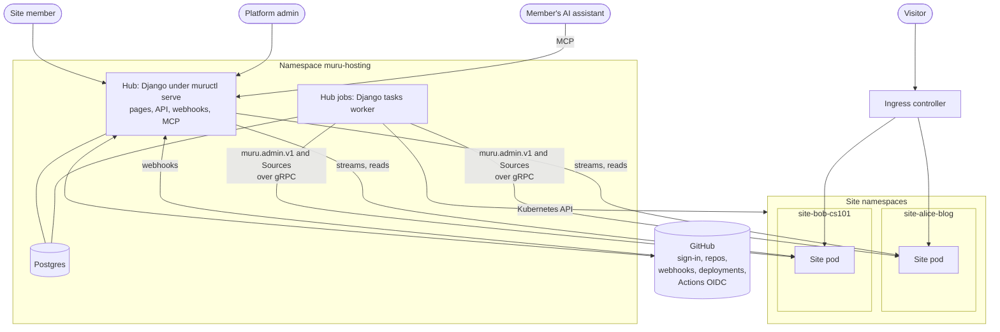

# 1. Overview

```{admonition} Design specification
:class: note

This page is part of the muru-hosting design specification and describes
intended design. See the [specification index](index.md) for how it is
maintained.
```

## 1.1 Purpose

muru-hosting is a proof of concept. Its purpose is Muru's, not its
users':

- **Dogfooding Muru with a real application.** Every part of the system
  runs on Muru, in each of Muru's three ways of running, with its
  conventions for settings, data, commands and deployment (section 1.6).

- **Validating Muru's APIs.** Everything the control plane does to a site
  goes through Muru's admin API, `muru.admin.v1`. A need the API does not
  meet is filed against Muru and worked around here until Muru closes it
  (section 11).

- **Extending Muru for hosting.** The design runs from what Muru can do
  today (stage 0) to what a hosting service needs, with Muru's controller
  and edge out of reach of the code they host (stage 1, section 12).

It is not a product, makes no promise of stability and is not going to
become a supported project.

## 1.2 Uses

The design serves three uses, which give it concrete requirements:

- **Your own set of sites:** one person or team deploying their own
  applications from GitHub, with releases, rollouts and rollbacks.

- **A small hosting service:** sites for different people, each isolated
  in its own namespace and managed by the people it belongs to.

- **Teaching:** a university course where each student gets a site,
  created in bulk by the staff, deployed by the student from their GitHub
  repository, and visible to the course's staff.

## 1.3 Principles

- **A separate repository that uses Muru's existing APIs.** It uses
  released versions of Muru from PyPI, pinned, and nothing from Muru's
  source tree. A workaround for a Muru gap is recorded beside the code
  it shapes, naming the Muru issue.

- **Kubernetes first, several tenants from the start.** A site is one pod
  in a namespace of its own. Kubernetes schedules, restarts and routes
  hostnames; Muru does releases, traffic and everything inside the pod.

- **Control through `muru.admin.v1` only.** The hub never runs `muructl`,
  never reads Muru's state store and never scrapes the dashboard. The
  site helper speaks `muru.admin.v1` itself, so that when Muru's split
  controller arrives with an admin listener of its own, the helper is
  removed and the hub does not change.

- **GitHub is the identity and the source.** People sign in with GitHub,
  who may sign in is a matter of GitHub users, organisations and teams,
  and code comes from GitHub repositories through one GitHub App.

- **Every action is checked by the hub and recorded by the hub.** Muru
  sees every call as coming from the helper, so the hub's audit log is
  the record of who did what until Muru carries an "on behalf of"
  principal (section 11.2).

## 1.4 The system



- **The hub** (section 2) is the control plane: a Django application with
  the pages, the webhook endpoint, an API for GitHub Actions and the MCP
  server, and a jobs worker that creates sites and deploys commits.

- **A site pod** (section 3) runs the Muru daemon with the site's
  releases, and the site helper (section 4), which the hub calls over
  gRPC.

- **GitHub** is where people sign in (section 5) and where code comes
  from (section 8).

## 1.5 Stages

- **Stage 0** works with Muru as it is today. The daemon and the site's
  code share the pod's main container, so the site's code can reach the
  daemon's state and admin socket. That is accepted for a first stage,
  which proves the hub, the accounts, the deploy path and the admin API. It
  is built in three phases: sites on a laptop, sites in Kind, then the
  hub in Kind (section 15.1).

- **Stage 1** follows Muru's split controller: Muru's controller, edge
  and admin listener in a trusted container, the site's code alone in
  its own, and the helper gone (section 12).

## 1.6 Muru in each part

| Part | Muru mode | Conventions it shows |
| --- | --- | --- |
| Hub | `muructl serve` | settings from the environment, `--data-dir` on a volume, a declared `migrate` command run by a Job, probes, handoff to ASGI for streams, the MCP server as an ASGI mount beside the Django application |
| Site helper | `muructl serve` | a gRPC servicer served by Muru, probes |
| Hosted sites | the daemon | releases, holds, blue/green and canaries, `before_fork` gates, the data directory, static files, declared commands, rolling restarts, maintenance |
