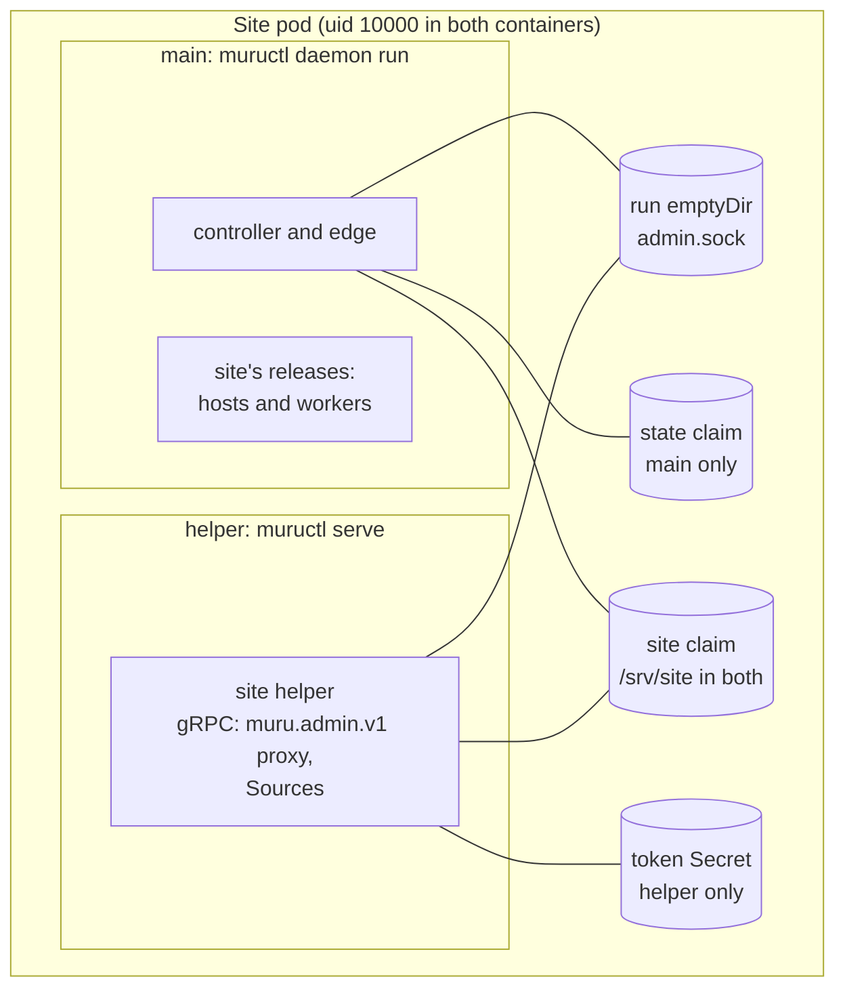

# 3. The site pod

```{admonition} Design specification
:class: note

This page is part of the muru-hosting design specification and describes
intended design. See the [specification index](index.md) for how it is
maintained.
```

This page describes the site pod of stage 0, which works with Muru as it
is. Section 12 describes the pod of stage 1.

## 3.1 Containers



- **main:** the hosting runtime image (muructl, the supported Pythons and
  uv), running `muructl daemon run` as uid 10000 with `--state-dir
  /var/lib/muru` and `--log-dir` on the `state` claim and `--run-dir
  /run/muru` on the `run` emptyDir. The daemon is the container's main
  process, as Muru's guide to the daemon in a container describes, and
  takes SIGTERM as a shutdown within its budget, set to fit the pod's
  `terminationGracePeriodSeconds`.

- **helper:** the helper image, running `muructl serve` on the helper's
  project (section 4), also as uid 10000, so that the admin socket, which
  the daemon guards by file permissions, opens to it. It mounts the `run`
  emptyDir at `/run/muru-site`, a path of its own so it does not meet
  `muructl serve`'s own run directory, and reaches the socket at
  `/run/muru-site/admin.sock`. It mounts `site` at `/srv/site`, the same
  path as main, because `Deploy` takes a path that the daemon reads as
  given.

In stage 0 the site's code runs in main beside the daemon, as the same
user, and can reach the state store and the admin socket. That is
accepted for this stage (section 1.5).

## 3.2 The daemon's configuration

A ConfigMap holds the daemon's file:

- the listener, plain HTTP on 8080, since TLS ends at the ingress;

- the trusted proxy settings for the ingress controller's addresses;

- the shutdown budget;

- the site's application table, with `data_dir = '/srv/site/data'`, so
  the data directory is on the claim that stage 1 shares.

Hosts and routes are applied by the hub with `ApplyConfig` (section 7.1),
since they change with a site's domains.

## 3.3 Volumes

| Volume | Holds | Mounted in |
| --- | --- | --- |
| `state` claim, ReadWriteOncePod | the state store, logs | main |
| `site` claim, ReadWriteOncePod | `sources/` with a directory per release, environments, the build cache, `data/` | main, helper |
| `run` emptyDir | the daemon's run directory, admin socket included | main, helper |
| `token` Secret | the bearer token the hub presents, and the helper's TLS certificate | helper |

The claims are ReadWriteOncePod on block-backed storage, since SQLite's
locks and write-ahead log need a local file system and two pods must
never mount them. The sources must outlive the pod: after a restart, the
daemon starts its releases again from those directories.

## 3.4 The Deployment

- One replica, `strategy: Recreate`.

- `automountServiceAccountToken: false`, so no container in the pod holds
  a cluster credential.

- Pod security Restricted: both containers non-root, no capabilities,
  `RuntimeDefault` seccomp, `fsGroup` for the claims.

- Resources from the site's plan (section 5.6).

## 3.5 Upgrading the pod

A new main or helper image changes the pod template, so the pod is
replaced and the site is briefly down. Deploying a site's code never
changes the pod. The hub upgrades images across sites in batches that an
admin starts, and says on each site's page when its pod was last
replaced and why.
