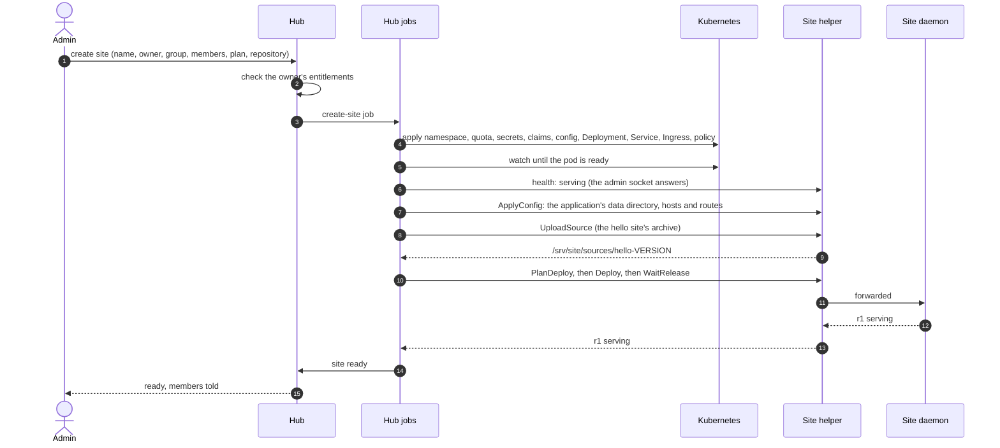

# 7. Site lifecycle

```{admonition} Design specification
:class: note

This page is part of the muru-hosting design specification and describes
intended design. See the [specification index](index.md) for how it is
maintained.
```

## 7.1 Creating a site



An owner whose entitlements let it create its own sites starts the same
job from its account page.

The hello site goes through the same upload and deploy path as a commit
from GitHub (section 8.3), so every new site proves that path before its
owner first pushes, and a broken pipeline shows at creation.

Every deploy asks Muru for a release that takes nothing from the release
before it (`fresh`): its settings come from its own source and from the
hub alone. Otherwise a site's first release of its owner's code would
inherit the hello site's settings.

The deploy job records how far it has got: the source's directory once
uploaded, and the release's id, taken from `PlanDeploy`, before the
release is made. A job run again skips the upload, and does not deploy
again a release the daemon already has.

## 7.2 The hello site

A small Muru application kept in this repository and built into an
archive with the hub's image.

- It shows the site's name, its hostname and the release serving
  (`MURU_RELEASE`), and the steps to deploy from GitHub: install the App
  on a repository, link it on the site's page, add `[tool.muru]`
  settings, push.

- The hub fills in what it knows through environment variables on the
  release: whether a repository is linked, whether the App can see it,
  and the site's page in the hub.

- It includes a minimal example project to copy. Until it does, the
  repository's `examples/` directory holds two: a Flask application and a
  FastAPI one, each with a `[tool.muru]` table, a `uv.lock` and declared
  commands (section 15.3.2).

- It carries a small original browser game, a static file served by the
  edge from the release's static directory and opened by clicking the
  logo five times. The player routes requests arriving at an edge to
  workers before the queue overflows, and partway through switches
  traffic from a blue release to a green one without dropping any:
  switching before the green workers are ready ends the game. It is
  played with buttons, the keys 1 to 3 and S, or by tapping a worker.

The hello site is release `r1`. The first push from GitHub becomes `r2`
and the hello release is retained like any other, so a rollback works on
a site's first day.

## 7.3 Removing a site

An admin, or an owner whose entitlements allow it, removes a site. A job
snapshots its volumes when the plan says so, removes its namespace and
everything in it, and marks the site removed in the hub, keeping its
audit entries.
