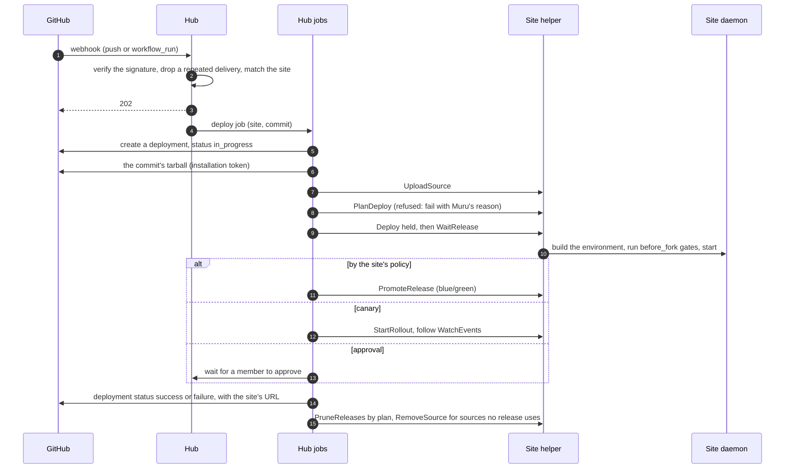

# 8. Deploying

```{admonition} Design specification
:class: note

This page is part of the muru-hosting design specification and describes
intended design. See the [specification index](index.md) for how it is
maintained.
```

## 8.1 The GitHub App

One GitHub App, installed on the repositories (or organisations) whose
code is deployed, covers sign-in, webhooks, fetching code and reporting
back:

- permissions: contents read, metadata read, deployments write, members
  read (for the sign-in rules of section 5.1);

- events: `push`, `workflow_run`, `installation`,
  `installation_repositories`;

- user authorisation, for sign-in.

## 8.2 Triggers

A site's trigger is one of:

- **push:** a push to the site's branch deploys its head commit.

- **after CI:** a `workflow_run` that completed with success on the
  site's branch, for a workflow the site names, deploys that run's
  commit.

- **from Actions:** a workflow step calls the hub's API with its GitHub
  Actions OIDC token, whose audience is the hub's URL. The hub verifies
  the token against GitHub's keys and checks its `repository`, `ref` and
  `workflow_ref` claims against the site. No shared secret is involved.

- **by hand:** a member picks a commit on the site's page, or asks for one
  through MCP.

## 8.3 The deploy job



- The webhook's signature is checked with the App's webhook secret, a
  delivery seen before is dropped, and the answer is sent before any
  work, since GitHub waits only ten seconds.

- GitHub credentials stay in the hub. The site pod needs no access to
  GitHub, and the code it receives has a known hash.

- The release id is Muru's next `rN`. The commit, branch, author and link
  are kept by the hub against the site and the id (section 11.2).

- The site's migrations are its own: a `before_fork` gate in its
  `[tool.muru.commands]` runs before any worker forks, and a failure
  fails the start before any traffic moves, which the hub reports.

- One deploy job runs at a time for a site. A newer commit that arrives
  while one runs waits behind it and replaces any older one waiting.

## 8.4 Other operations

| Operation | Through |
| --- | --- |
| Roll back | `Rollback` to the retained release |
| Promote a held release | `PromoteRelease` |
| Control a canary | `PauseRollout`, `ResumeRollout`, `PromoteRollout`, `AbortRollout` |
| Restart workers | `Debug` with the `restart` operation, Muru's rolling restart |
| Maintenance page | `SetMaintenance` |
| Declared commands | `ListCommands`, `RunCommand` with `detach`, then `TailCommandRun` streamed to the browser |
| Logs and events | `TailLogs` and `WatchEvents` streamed; `ListEvents` for history |
| Metrics | `GetMetrics` read by the hub for its charts, or Prometheus scraping each site |
| Custom domains | section 9 |
| Recreate the pod (admin) | delete the pod; the Deployment makes another |
