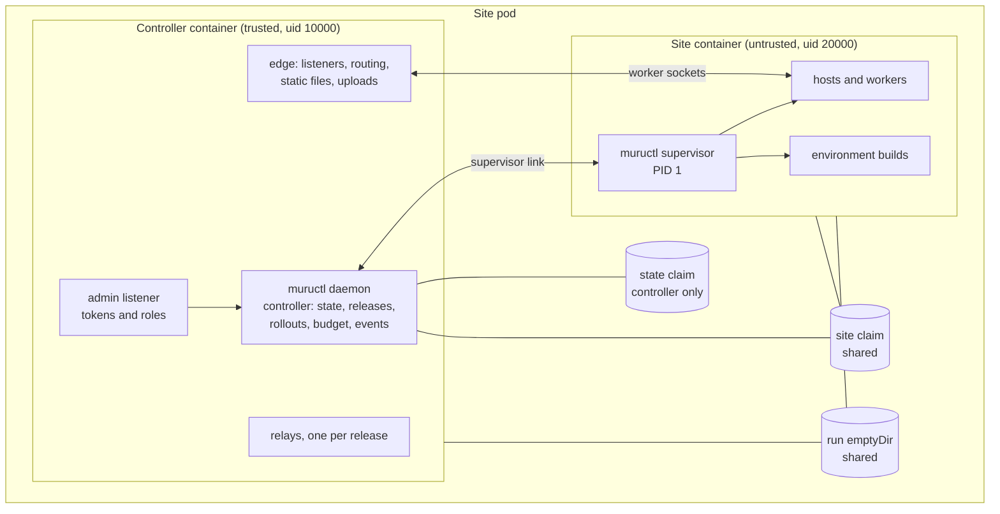

# 12. Stage 1: the split controller

```{admonition} Design specification
:class: note

This page is part of the muru-hosting design specification and describes
intended design. See the [specification index](index.md) for how it is
maintained.
```

Stage 1 follows Muru's split controller (muruhq/muru#148). Muru's
controller and edge run in the site's pod beside the site's code but out
of its reach, and the helper of section 4 is removed.

## 12.1 The pod



- **The controller container** holds the controller, the edge, the relays
  and an admin listener with tokens and roles (muruhq/muru#146), which the
  hub calls in place of the helper. The admin socket stays in this
  container's own run directory.

- **The site container** runs `muructl supervisor run` as PID 1, which
  starts, signals, measures and reaps the site's processes and runs its
  environment builds. If the site's code interferes with the supervisor,
  its container restarts and the site with it; it cannot reach the state.

- **The shared `run` emptyDir** carries every socket that crosses between
  the containers: the supervisor link, the workers' sockets that the edge
  connects to, the hosts' control sockets and the relays' output socket.
  Both containers share the node's kernel, so Unix sockets, descriptor
  passing and peer credentials work between them.

- **Different uids,** with `fsGroup` giving both containers group access
  to `site` and `run`, and pod security Restricted throughout.

## 12.2 The edge in a container of its own

The edge is the part that parses traffic from the internet, so it is the
likeliest way in. As an option, it runs in a third container that mounts
`site` read-only, a spool emptyDir of its own and the TLS secret, and
nothing of `state`, and talks to the controller through a socket on an
emptyDir only the two mount. That is also where a certificate's key
would live with Muru's own ACME (section 9.2).

## 12.3 What the site's code can and cannot affect

- **Out of reach:** the state store, secrets other than the site's own,
  events and audit, logs once the relay has read them, the admin
  listener's credentials, the controller's memory, the edge's TLS keys
  and the upload spool.

- **Its own to change:** its code, environments, data directory, hosts
  and workers, and the supervisor. Misusing them harms only its own site.

- **Boundaries to harden,** since the site's code controls the other side
  of each: the supervisor link, the worker protocol read by the edge, the
  files on the `site` claim that the edge reads, and the admin listener.

## 12.4 What changes in muru-hosting

- The helper sidecar is replaced by the controller container. The hub
  changes the address it calls and nothing else, since it already speaks
  `muru.admin.v1`.

- Sources arrive through Muru's own call for them (section 11.2), and the
  `Sources` service goes.

- The templates of section 6.1 gain the second container's volumes and,
  with the option of section 12.2, a third container.
